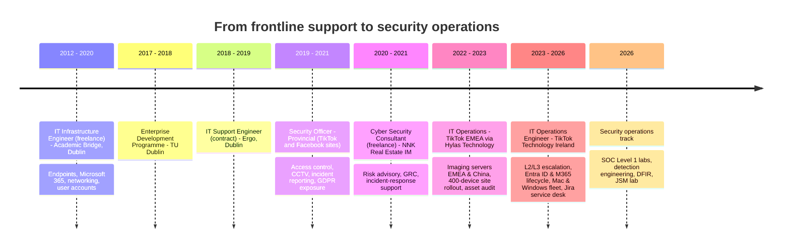
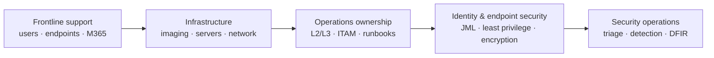

# Marcus Paula

### IT Operations Engineer → Security Operations

**14 years in IT (since 2012) · 4 years in TikTok's EMEA IT team, Dublin · Identity, endpoints and service management · Building a SOC / blue-team skill set in public**

> I keep IT running, then I make it repeatable and secure: recurring problems become documented, tested and automated processes.

---

## At a glance (30-second read)

| | |
|---|---|
| **Current level** | IT Operations Engineer, L2/L3 escalation point (TikTok Technology Ireland, 2022–2026) |
| **Core strengths** | Identity & access (Entra ID, AD, M365) · Windows & macOS endpoint lifecycle · Jira service desk · ITAM · PowerShell automation |
| **Measured results** | Device preparation **60 → 15 min** · imaging network **100 Mbps → 1 Gbps** · **5,000+ assets** reconciled to **99%** audit visibility · **~400 devices** deployed at one Dublin site |
| **Security track** | 26 TryHackMe SOC Level 1 rooms documented · Sigma & Sentinel detection labs · DFIR playbooks · IAM / Zero Trust lab |
| **Education** | Postgraduate study in Cyber Security, NCI (programme on hold) · Enterprise Development Programme, TU Dublin |
| **Languages** | English (full professional) · Portuguese (native) |

---

## Career journey

**How the skills built on each other**

---

## Enterprise experience: TikTok EMEA, Dublin (Jan 2022 – Oct 2026)

*Contract via Hylas Technology (Jan 2022 – Feb 2023), then full-time IT Operations Engineer (Mar 2023 – Oct 2026). The role ended when TikTok centralised its EMEA service desk.*

- **Escalation point (L2/L3)** for identity, access, VPN, network, endpoint and server incidents, owned through to resolution and written up as reusable runbooks.
- **Identity lifecycle:** created and disabled Entra ID accounts, reset passwords and MFA, assigned Microsoft 365 licences, groups and shared mailboxes.
- **Endpoint lifecycle:** Macs via Apple Business Manager + Puppet, Windows via imaging + BitLocker/MBAM; lock, wipe, return and redeploy.
- **Service desk:** Jira daily as an agent, with country queues owned by teams and tickets pre-assigned to engineers.
- **Projects:** imaging servers across EMEA & China (10 → 50 devices/hour), 400-device Dublin rollout, Lark migration and 25 new meeting rooms, asset audit across three sites.

Employer names identify employment history only. No internal data, screenshots, tickets or system details are published here.

---

## Portfolio: proof, not just claims

Every repository says what is **professional work**, a **hands-on lab** or **study**, and what it does *not* prove.

### IT operations & identity

| Repository | What it shows |
|---|---|
| [**active-directory-automation**](https://github.com/marcuspaula-seceng/active-directory-automation) | PowerShell joiner/mover/leaver, access reviews, privileged-account audit. `-WhatIf` first, Pester tests, CI |
| [**iam-zero-trust-architecture**](https://github.com/marcuspaula-seceng/iam-zero-trust-architecture) | Identity lifecycle and Zero Trust reference design with automation examples |
| [**it-operations-writeups**](https://github.com/marcuspaula-seceng/it-operations-writeups) | Short technical write-ups from my home lab, with measured numbers |

### Security operations & detection

| Repository | What it shows |
|---|---|
| [**cybersecurity-labs**](https://github.com/marcuspaula-seceng/cybersecurity-labs) | **26 TryHackMe SOC Level 1 rooms**, step by step with screenshots (Splunk, SIEM, EDR, phishing, MITRE ATT&CK, Wireshark), plus Hack The Box write-ups |
| [**sentinel-detection-lab**](https://github.com/marcuspaula-seceng/sentinel-detection-lab) | Microsoft Sentinel analytics rules, local KQL evaluator, 45 fixtures, triage playbook, CI |
| [**windows-detection-engineering-lab**](https://github.com/marcuspaula-seceng/windows-detection-engineering-lab) | Sigma rules for Windows validated in CI against public EVTX samples |
| [**dfir-playbook**](https://github.com/marcuspaula-seceng/dfir-playbook) | Incident-response runbooks, triage scripts, chain of custody, evidence templates |

### Cloud & AI security

| Repository | What it shows |
|---|---|
| [**cloud-threat-hunting-platform**](https://github.com/marcuspaula-seceng/cloud-threat-hunting-platform) | AWS threat hunting: Athena queries, Terraform, GuardDuty / Security Hub design |
| [**llm-agent-security-lab**](https://github.com/marcuspaula-seceng/llm-agent-security-lab) | Measured prompt-injection tests on a local LLM (5/5 leaked → 0/5 with the fix), CI |

---

## Skills

**Professional (hands-on at work)**

**Automation & engineering**

**Security (labs & study)**

*Labs & study are clearly separated from production experience in every repository.*

---

## Currently

- Completing the **TryHackMe SOC Level 1** path (phishing, network traffic, Windows and Linux monitoring, SIEM triage).
- Building out a **Jira Service Management** lab: request types, SLAs, queues, automation, Assets (CMDB), change with CAB approval.
- Next certifications: **SC-200**, **MD-102**, **Jamf 100**.

---

**Hiring for IT operations, infrastructure or SOC roles in Ireland?** Let's talk → [LinkedIn](https://www.linkedin.com/in/marcuspaula/)

